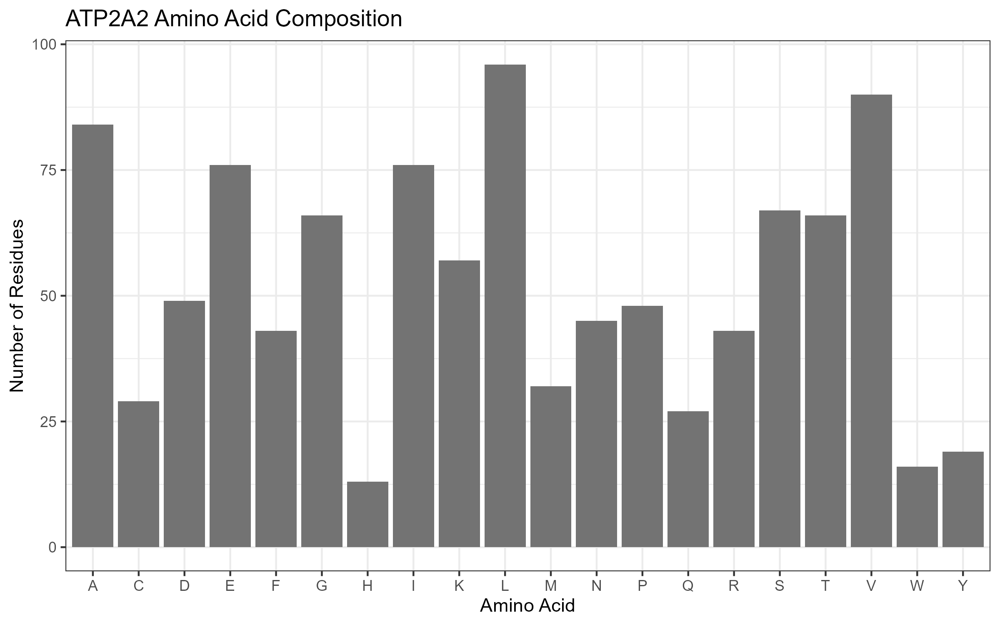

# Muscle-Contractility-ATP2A2

# Molecular Mechanisms of Muscle Contractility: ATP2A2 Gene and p.Pro602Leu Variant Analysis

## 1. Project Overview

This project investigates the molecular mechanisms of muscle contractility through the analysis of the human **ATP2A2 gene**, which encodes sarcoplasmic/endoplasmic reticulum calcium ATPase 2 (SERCA2).

The activity focuses on retrieving the reference gene and protein sequences from the National Center for Biotechnology Information (NCBI), analyzing protein length and amino-acid composition using R, examining a documented genetic variant from ClinVar, and relating its molecular consequences to calcium regulation and muscle physiology.

The project also demonstrates a reproducible bioinformatics workflow using RStudio and GitHub.

## 2. Student and Assignment Information

| Information | Details |
|---|---|
| Student Number | 202303476 |
| Assignment Number | 24 |
| Organism | *Homo sapiens* |
| Gene Symbol | ATP2A2 |
| Gene Name | ATPase sarcoplasmic/endoplasmic reticulum Ca2+ transporting 2 |
| NCBI Gene ID | 488 |
| Chromosome | 12 |
| Reference Transcript | NM_170665.4 |
| Reference Protein | NP_733765.1 |
| Protein Isoform | SERCA2b |
| ClinVar Variation ID | 17799 |
| Nucleotide Variant | c.1805C>T |
| Protein Variant | p.Pro602Leu |
| Variant Classification | Pathogenic |
| Variant Type | Missense |

## 3. Research Question

How does the ATP2A2 gene contribute to calcium regulation in muscle cells, and what are the possible molecular consequences of the documented p.Pro602Leu missense variant on SERCA2 protein function?

## 4. Background and Biological Significance

The ATP2A2 gene encodes SERCA2, a calcium-transporting ATPase located in the sarcoplasmic and endoplasmic reticulum membranes. This protein plays an important role in maintaining intracellular calcium homeostasis.

In muscle cells, calcium ions regulate the interaction between actin and myosin, which is essential for muscle contraction. SERCA2 uses energy obtained from ATP hydrolysis to transport calcium ions from the cytoplasm back into the sarcoplasmic reticulum. This reduction in cytoplasmic calcium contributes to muscle relaxation.

The assigned variant, p.Pro602Leu, involves the substitution of proline with leucine at amino-acid position 602. ClinVar classifies this variant as pathogenic and associates it with acrokeratosis verruciformis of Hopf.

Published functional studies have reported impaired calcium transport and ATPase activity associated with this variant.

## 5. Objectives

1. Retrieve the assigned human ATP2A2 gene record using R and NCBI.
2. Identify the corresponding reference protein accession and retrieve its FASTA sequence.
3. Calculate the reference protein length and determine the frequency of the 20 standard amino acids.
4. Investigate the assigned ClinVar variant and document its molecular and clinical information.
5. Generate a protein-position visualization showing the location of the assigned amino-acid substitution.
6. Explain the relationship between ATP2A2, SERCA2 function, calcium regulation, and the assigned variant.
7. Publish the complete workflow, results, figures, and references in a reproducible GitHub repository.

## 6. Materials and Bioinformatics Tools

| Tool / Database | Purpose |
|---|---|
| RStudio 4.5.3 | Computational analysis |
| R package: rentrez | Retrieving NCBI records |
| R package: ggplot2 | Generating scientific visualizations |
| NCBI Gene | Gene information |
| NCBI Nucleotide | Reference transcript |
| NCBI Protein | Reference protein sequence |
| NCBI ClinVar | Documented genetic variant |
| GitHub | Project documentation and publication |
| UniProt | Protein functional information |
| RCSB PDB / AlphaFold DB | Protein structural information |

## 7. Methodology

### Step 1. RStudio Project Setup

A new RStudio project named `Muscle_Contractility_ATP2A2` was created.

The project was organized into the following directories:

- `data/`
- `results/`
- `figures/`

An R script named `analysis.R` was created to document and execute the computational procedures.

The required packages were installed and loaded:

```r
install.packages(c("rentrez", "ggplot2"))

library(rentrez)
library(ggplot2)
```

### Step 2. Retrieval of the Human ATP2A2 Gene Record

The `rentrez` package was used to search the NCBI Gene database using the assigned gene symbol and human taxonomy ID (9606).

The retrieved record was verified to ensure that the exact gene symbol was ATP2A2.

The following information was collected:

- Gene symbol
- NCBI Gene ID
- Official gene name
- Chromosome location

The information was saved as:

`results/gene_summary.txt`

### Step 3. Retrieval of the Matching Reference Protein

The assigned transcript, NM_170665.4, was retrieved from the NCBI Nucleotide database using `entrez_fetch()`.

The corresponding RefSeq protein accession was extracted from the GenBank record.

The matching protein sequence was retrieved from NCBI Protein in FASTA format.

The following files were generated:

- `data/ATP2A2_protein.fasta`
- `results/protein_accession.txt`

The retrieved reference protein accession was NP_733765.1.

### Step 4. Protein Length and Amino-Acid Composition Analysis

The retrieved FASTA sequence was read into R using `readLines()`.

The protein sequence was separated from its FASTA header and converted into individual amino-acid residues.

The total protein length was calculated using `length()`.

The frequencies of the 20 standard amino acids were determined using `table()` and `factor()`.

A frequency table was generated and saved in CSV format.

The `ggplot2` package was used to generate an amino-acid composition bar graph.

Generated files:

- `results/amino_acid_composition.csv`
- `figures/01_amino_acid_composition.png`

### Step 5. ClinVar Variant Investigation

The assigned ClinVar Variation ID (17799) was examined using the NCBI ClinVar database.

The following information was documented:

- Variant nomenclature
- Reference transcript
- Nucleotide and protein changes
- Variant classification
- Associated condition
- Review status
- Supporting publications

The ClinVar findings were saved as:

`results/clinvar_summary.txt`

### Step 6. Protein-Position Visualization

The protein-level variant notation, p.Pro602Leu, was analyzed to identify the affected amino-acid position.

The reference protein length and mutation position were used to generate a linear protein-position plot using `ggplot2`.

The visualization identifies residue 602 within the 1,042-amino-acid reference protein.

The resulting figure was saved as:

`figures/02_variant_position.png`

### Step 7. Molecular Mechanism Analysis

The normal biological function of SERCA2 was examined in relation to calcium transport and muscle physiology.

The documented p.Pro602Leu variant was evaluated by considering its nucleotide substitution, amino-acid replacement, clinical classification, and reported experimental evidence.

A proposed validation experiment involving ATPase activity measurement and calcium transport analysis was developed.

### Step 8. GitHub Publication

The R script, FASTA sequence, generated results, and figures were organized into a public GitHub repository.

A README.md file was prepared to document the research background, objectives, methodology, results, variant interpretation, limitations, and references.

## 8. Results

### 8.1 Gene Retrieval Results

The NCBI Gene database successfully identified the assigned ATP2A2 gene.

| Parameter | Retrieved Result |
|---|---|
| Gene Symbol | ATP2A2 |
| NCBI Gene ID | 488 |
| Official Gene Name | ATPase sarcoplasmic/endoplasmic reticulum Ca2+ transporting 2 |
| Chromosome | 12 |

The retrieved information was saved in `gene_summary.txt`.

### 8.2 Reference Protein Retrieval Results

The assigned transcript NM_170665.4 was successfully matched with its corresponding RefSeq protein.

| Parameter | Result |
|---|---|
| Transcript | NM_170665.4 |
| Protein Accession | NP_733765.1 |
| Protein Name | SERCA2b |
| Protein Length | 1,042 amino acids |
| Sequence Format | FASTA |

The reference protein sequence was saved as `ATP2A2_protein.fasta`.

### 8.3 Amino-Acid Composition Results

The amino-acid composition analysis was successfully performed using R.

The frequency table contains the counts of all 20 standard amino acids.

The three most abundant amino acids were identified by sorting the frequency table according to their residue counts.

The exact frequencies can be examined in:

`results/amino_acid_composition.csv`

**Figure 1. Amino-Acid Composition of ATP2A2**



The bar graph illustrates the distribution of amino-acid residues throughout the reference protein sequence.

The composition analysis provides information about residue frequency but cannot independently establish protein function, structural stability, or the functional effect of a genetic variant.

### 8.4 ClinVar Variant Results

The assigned ATP2A2 variant was identified in ClinVar.

| Parameter | Result |
|---|---|
| ClinVar Variation ID | 17799 |
| Transcript | NM_170665.4 |
| Nucleotide Change | c.1805C>T |
| Protein Change | p.Pro602Leu |
| Variant Type | Missense |
| Associated Condition | Acrokeratosis verruciformis of Hopf |
| Aggregate Classification | Pathogenic |
| Review Status | Criteria provided, multiple submitters, no conflicts |

The variant involves a single-nucleotide substitution that changes the amino acid at position 602 from proline to leucine.

### 8.5 Protein-Position Visualization

The protein-position plot illustrates the location of the assigned missense variant within the reference protein.

**Figure 2. Position of the ATP2A2 p.Pro602Leu Variant**


The red marker represents residue 602 within the 1,042-amino-acid reference protein.

This visualization establishes the location of the amino-acid substitution but does not independently demonstrate its structural or functional consequences.

## 9. Molecular Mechanism Discussion

The ATP2A2 gene encodes sarcoplasmic/endoplasmic reticulum calcium ATPase 2 (SERCA2), a membrane-associated protein responsible for transporting calcium ions from the cytoplasm into the sarcoplasmic or endoplasmic reticulum. This process is essential for maintaining intracellular calcium homeostasis. In muscle cells, calcium regulation is particularly important because cytoplasmic calcium concentrations control the interaction between actin and myosin during contraction and relaxation.

The normal SERCA2 protein utilizes energy obtained from ATP hydrolysis to transport calcium ions against their concentration gradient into the sarcoplasmic or endoplasmic reticulum. As cytoplasmic calcium decreases, the contractile machinery can return to its relaxed state. Therefore, impaired SERCA2 activity may interfere with normal calcium regulation and cellular functions.

The assigned ATP2A2 variant, NM_170665.4:c.1805C>T (p.Pro602Leu), is a missense mutation involving the substitution of proline with leucine at amino-acid position 602. This change results from a single-nucleotide substitution and does not alter the protein reading frame. However, replacing proline with leucine may affect the local structural properties of the protein.

ClinVar classifies this variant as pathogenic and associates it with acrokeratosis verruciformis of Hopf. Published functional studies have reported undetectable ATPase activity and impaired calcium binding and transport in the mutant protein. These findings suggest that the substitution negatively affects SERCA2 function. Nevertheless, computational predictions and experimental observations should be distinguished, and the specific structural mechanism responsible for the functional impairment requires further investigation.

The proposed molecular relationship can be summarized as follows: an ATP2A2 genetic alteration produces a SERCA2 protein substitution, potentially impairing ATPase activity and calcium transport, which may disturb intracellular calcium homeostasis. A suitable validation experiment would involve expressing wild-type and mutant SERCA2 proteins in an appropriate cell model, followed by ATPase activity measurements and calcium imaging to compare their calcium transport capacities.

## 10. Proposed Validation Experiment

**Experiment: Comparison of ATPase Activity and Calcium Transport Between Wild-Type and Mutant SERCA2**

The proposed experiment aims to investigate whether the p.Pro602Leu substitution affects the calcium-transporting activity of SERCA2.

Two experimental groups would be established:

1. Wild-type group: Cells expressing the normal SERCA2 protein.
2. Mutant group: Cells expressing the ATP2A2 p.Pro602Leu variant.

ATPase activity measurements would be conducted to compare the ability of both protein forms to hydrolyze ATP.

Calcium imaging or an appropriate calcium-uptake assay would also be used to evaluate differences in calcium transport.

A reduction in ATPase activity and calcium uptake in the mutant group compared with the wild-type group would support the proposed loss-of-function mechanism.

This is a proposed experiment and was not performed as part of the present computational laboratory activity.

## 11. Answers to the Required Guide Questions

### 1. What does your assigned gene encode, and how does this protein contribute to muscle function?

The ATP2A2 gene encodes SERCA2, a calcium-transporting protein that pumps calcium from the cytoplasm into the sarcoplasmic/endoplasmic reticulum. This helps maintain calcium homeostasis and promotes muscle relaxation after contraction.

### 2. What was the exact protein accession and length retrieved with R?

The retrieved reference protein was **NP_733765.1 (SERCA2b)**, corresponding to transcript NM_170665.4. It contains **1,042 amino-acid residues**.

### 3. What did the amino-acid composition chart show? What can it NOT tell you?

The chart shows the frequency and distribution of the 20 standard amino acids in ATP2A2. It identifies the most abundant residues but cannot establish protein structure, biochemical activity, or mutation effects. Exact counts are available in `results/amino_acid_composition.csv`.

### 4. What is your fixed ClinVar variant, and what is its current classification and evidence strength?

The assigned variant is **NM_170665.4:c.1805C>T (p.Pro602Leu)**, ClinVar ID **17799**. It is a missense variant classified as **Pathogenic**, with multiple submitters and no conflicting interpretations. Functional studies report impaired ATPase activity and calcium transport.

### 5. What is the scientifically supported mechanism linking this variant to muscle function, and what remains uncertain?

The p.Pro602Leu substitution has been associated with impaired SERCA2 activity and calcium transport. Since SERCA2 regulates calcium homeostasis, its dysfunction may affect muscle relaxation. However, the variant is clinically associated with acrokeratosis verruciformis of Hopf, and a specific muscle-contractility disorder has not been established. Its precise structural effects remain uncertain.

### 6. What additional experiment would help test the proposed mechanism?

Compare wild-type and mutant SERCA2 using ATPase activity assays and calcium imaging. Reduced ATPase activity and calcium transport in the mutant would support the proposed loss-of-function mechanism. This experiment is proposed and was not performed in this activity.

## 12. Limitations

1. The investigation was based primarily on publicly available sequence records, clinical databases, and previously published studies.
2. Amino-acid composition alone cannot establish the three-dimensional structure or biological activity of a protein.
3. The protein-position visualization indicates the location of the variant but does not demonstrate a structural defect.
4. The reported functional effects of p.Pro602Leu were obtained from previously published experimental studies and were not independently reproduced in this activity.
5. Computational predictions may differ from experimental findings.
6. Although ATP2A2 is involved in calcium regulation and muscle physiology, the documented clinical association of the assigned variant is acrokeratosis verruciformis of Hopf. A specific muscle-contractility phenotype should not be assumed.
7. Additional structural and functional experiments are necessary to investigate the detailed molecular consequences of the variant.

## 13. Conclusion

The computational analysis successfully retrieved the human ATP2A2 gene and its corresponding reference protein sequence using R and the NCBI database.

The reference protein NP_733765.1 was identified as SERCA2b and contained 1,042 amino-acid residues. Amino-acid composition analysis and protein-position visualization were also successfully performed.

The assigned missense variant, c.1805C>T (p.Pro602Leu), was documented in ClinVar as pathogenic and associated with acrokeratosis verruciformis of Hopf. Previously published functional studies reported impaired ATPase activity and calcium transport.

Overall, the activity demonstrates the importance of integrating gene information, protein sequence analysis, variant databases, and biological interpretation to investigate the molecular mechanisms underlying genetic variation.

## 14. Reproducibility and Repository Structure

The complete R analysis script and generated outputs are included in this repository.

```text
Muscle-Contractility-ATP2A2/
│
├── README.md
├── analysis.R
│
├── data/
│   └── ATP2A2_protein.fasta
│
├── results/
│   ├── gene_summary.txt
│   ├── protein_accession.txt
│   ├── amino_acid_composition.csv
│   └── clinvar_summary.txt
│
└── figures/
    ├── 01_amino_acid_composition.png
    └── 02_variant_position.png
```

To reproduce the analysis:

1. Install R and RStudio.
2. Download or clone this repository.
3. Open the RStudio project or working directory.
4. Install the required packages:

```r
install.packages(c("rentrez", "ggplot2"))
```

5. Load the packages:

```r
library(rentrez)
library(ggplot2)
```

6. Open `analysis.R`.
7. Execute the script sequentially.
8. Ensure that an active internet connection is available for NCBI retrieval.

The analysis script automatically retrieves the assigned gene and protein information and generates the required result files and visualizations.

## 15. References and Data Sources

1. National Center for Biotechnology Information (NCBI). ATP2A2 Gene Record, Gene ID: 488.  
   https://www.ncbi.nlm.nih.gov/gene/488/

2. National Center for Biotechnology Information (NCBI). ATP2A2 Reference Transcript, NM_170665.4.  
   https://www.ncbi.nlm.nih.gov/nuccore/NM_170665.4

3. National Center for Biotechnology Information (NCBI). ATP2A2 Reference Protein, NP_733765.1.  
   https://www.ncbi.nlm.nih.gov/protein/NP_733765.1

4. National Center for Biotechnology Information (NCBI). ClinVar Variation ID: 17799, NM_170665.4:c.1805C>T (p.Pro602Leu).  
   https://www.ncbi.nlm.nih.gov/clinvar/variation/17799/

5. UniProt. SERCA2 – ATP2A2, UniProt Accession: P16615.  
   https://www.uniprot.org/uniprotkb/P16615/entry

6. Dhitavat, J., et al. (2003). Functional analysis of ATP2A2 mutations in acrokeratosis verruciformis of Hopf. Refer to the supporting publication indexed in ClinVar, PMID: 12542527.  
   https://pubmed.ncbi.nlm.nih.gov/12542527/

7. Dode, L., et al. (2003). Functional evidence concerning ATP2A2 mutations and calcium transport. See supporting publications indexed in ClinVar, including PMID: 12975374.  
   https://pubmed.ncbi.nlm.nih.gov/12975374/

8. National Center for Biotechnology Information (NCBI). ClinVar Variant Record and Supporting Submissions.  
   https://www.ncbi.nlm.nih.gov/clinvar/variation/17799/

**Database access date:** November 14, 2026.

---

*This repository was prepared as an individual Cell and Molecular Biology laboratory activity on the molecular mechanisms of muscle contractility and the analysis of documented human genetic variation.*
